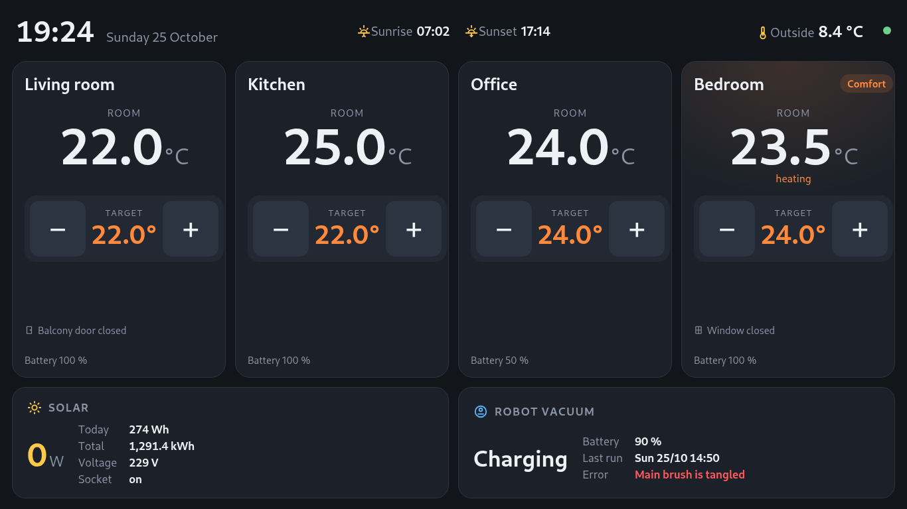

<a href="https://steitec.net"><picture>
  <source media="(prefers-color-scheme: dark)" srcset="https://raw.githubusercontent.com/steitec/.github/main/brand/steitec-logo-on-dark.svg">
  
</picture></a>

# kiosk-kit

Turn a Debian machine with GNOME into a touch kiosk that shows one web page —
and keeps showing it, unattended, for months.



*The setup this kit comes from: an ADLINK SP-AL industrial panel PC (Atom E3930,
1366×768, PenMount touch) running a home-automation dashboard on the wall
(room names changed for the screenshot).*

Getting Chromium to open full screen is the easy part. The details below are
the ones that took real nights to find, and they are all handled here:

- **Display off when idle, touch wakes it — and the waking touch is swallowed.**
  GNOME's own blanking can't do this: Mutter disables the touchscreen while the
  output is powered down, so no touch would ever wake it. A small service
  watches the evdev devices itself, switches the output via Mutter's D-Bus API
  and grabs the touchscreen (`EVIOCGRAB`) while dark, so the tap that wakes the
  screen doesn't also press whatever button is under the finger.
- **Chromium survives its own updates.** A browser that keeps running across a
  package update tends to end in "Aw, Snap!". An apt hook restarts the kiosk
  browser when the binary on disk is newer than the running process.
- **No "Restore pages?" bubble** after a power cut, no translate prompt, no
  password manager, no notifications.
- **Fresh pages after a server update**, even when the server sends one-year
  cache headers: the disk cache is cleared before every start.
- **Waits for the server after boot** instead of showing an error page.
- **Touch calibration that works on Wayland**, via a udev rule and libinput's
  calibration matrix (X11-only `xorg.conf` calibration silently stops working).
- **No lock screen, no blanking, no overview at login** — set system-wide via
  dconf and locked, plus a tiny GNOME Shell extension that skips the
  Activities overview GNOME 40+ shows after login.
- **Security updates on their own**, rebooting at night only when required.

## Quick start

```bash
git clone https://github.com/steitec/kiosk-kit && cd kiosk-kit
cp kiosk.conf my-kiosk.conf && nano my-kiosk.conf   # at least KIOSK_URL
./install.sh --config my-kiosk.conf --dry-run        # see what would change
sudo ./install.sh --config my-kiosk.conf
sudo reboot
```

Running the installer again after editing the config is safe: files are
rewritten and settings replaced, never appended.

## Configuration

| Setting | Default | Meaning |
|---|---|---|
| `KIOSK_URL` | – | Page to show |
| `KIOSK_USER` | – | Account that logs in automatically (created if missing) |
| `KIOSK_LANG` | `en` | Browser UI language |
| `WAIT_TIMEOUT` | `120` | Seconds to wait for the server after boot |
| `CLEAR_CACHE` | `yes` | Clear the browser cache before every start |
| `DISPLAY_IDLE` | `300` | Seconds until the display switches off; `0` = never |
| `TOUCH_NAME` | empty | Touchscreen name filter; empty = any udev touchscreen |
| `TOUCH_USB_ID` | empty | `vendor:product` for calibration, e.g. `14e1:6000` |
| `TOUCH_CALIBRATION` | empty | Six numbers: first two rows of the libinput matrix |
| `UPDATES` | `yes` | Unattended security updates |
| `REBOOT_TIME` | `04:00` | When to reboot if an update requires it |

The installer validates every value before touching the system and writes the
checked, complete configuration to `/etc/kiosk-kit/kiosk.conf`.

## What it changes

| Path | Purpose |
|---|---|
| `/etc/kiosk-kit/kiosk.conf` | runtime configuration |
| `/usr/local/bin/kiosk-browser` + `/etc/xdg/autostart/kiosk-browser.desktop` | browser launcher and restart loop |
| `/usr/local/sbin/kiosk-display` + `kiosk-display.service` | display off when idle, touch wakes |
| `/etc/gdm3/daemon.conf` | automatic login |
| `/etc/dconf/profile/user`, `/etc/dconf/db/local.d/` | GNOME settings, locked |
| `/usr/share/gnome-shell/extensions/kiosk-no-overview@kiosk-kit/` | skip the overview at login |
| `/etc/chromium/policies/managed/kiosk-kit.json` | browser policy |
| `/etc/udev/rules.d/99-kiosk-touch-calibration.rules` | touch calibration (optional) |
| `/etc/apt/apt.conf.d/*kiosk-kit*`, `20auto-upgrades` | updates, browser restart after updates |

## How the display service works

```
          idle for DISPLAY_IDLE s           any input
 awake ──── grab touch, display off ──▶ dark ──── display on ──▶ waking
   ▲                                                               │
   └──────────── finger lifted (0.4 s quiet): release touch ───────┘
```

The state machine (`IdleController` in `files/kiosk-display.py`) is pure logic
and unit-tested with simulated input; the I/O around it is a thin layer.

## Supported systems

- **Debian 12 (bookworm), GNOME 43, Wayland** — the reference panel above runs
  the scripts this kit was extracted from, in daily use since October 2026.
- GNOME 45+ (Debian 13) uses the ES-module version of the shell extension; it
  is included but has not been tested on hardware yet.
- Not for Ubuntu as is: Chromium is a snap there, with different paths.

## Tests

```bash
python -m venv .venv && .venv/bin/pip install pytest shellcheck-py
.venv/bin/pytest            # state machine + installer against a temp root
.venv/bin/shellcheck -x install.sh files/kiosk-browser files/kiosk-chromium-restart
```

The installer tests run `install.sh --root <tmpdir>` (commands are announced,
not executed) and check the files it writes: autologin replaces Debian's
commented defaults instead of duplicating them, a second run changes nothing,
invalid settings are rejected before anything is written. CI runs them on
Ubuntu and inside a Debian 12 container.

## License

MIT
